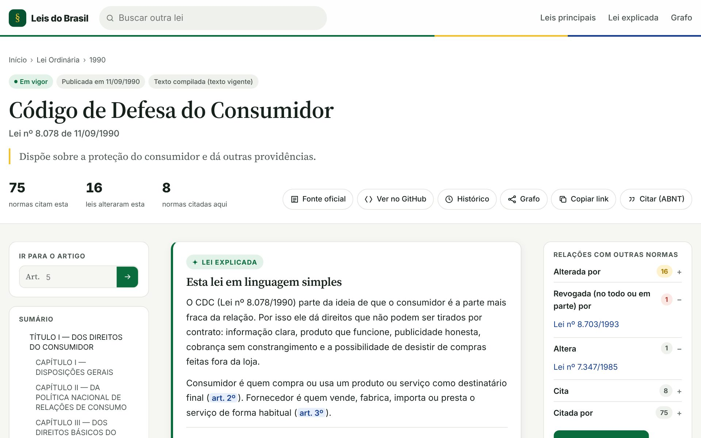
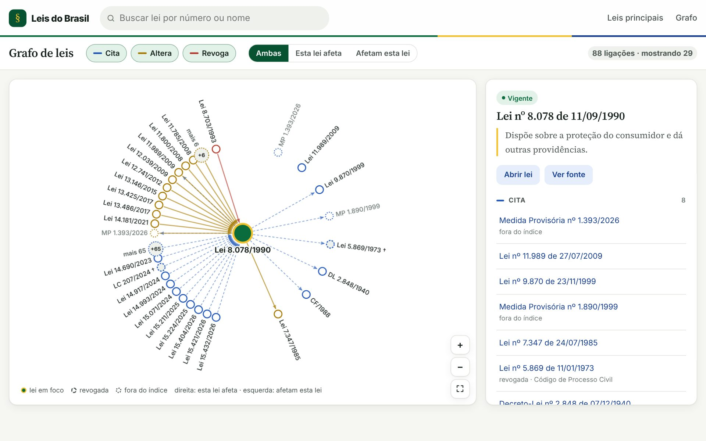
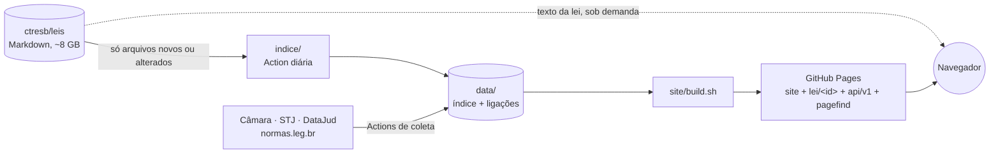

<div align="center">

# § Leis do Brasil

**As leis federais do Brasil (e as estaduais de SP, RJ e MG), fáceis de achar e de ler.**

Índice, site navegável, grafo e API aberta sobre o acervo [ctresb/leis](https://github.com/ctresb/leis), atualizados todos os dias por GitHub Actions.

[](https://gabriel00lima.github.io/leis-indice/)
[](https://gabriel00lima.github.io/leis-indice/api.html)
[](https://github.com/gabriel00lima/leis-indice/actions/workflows/testes.yml)
[](https://github.com/gabriel00lima/leis-indice/actions/workflows/indice.yml)
[](https://github.com/gabriel00lima/leis-indice/actions/workflows/deploy-site.yml)
[](LICENSE)

[**Abrir o site**](https://gabriel00lima.github.io/leis-indice/) · [Documentação da API](https://gabriel00lima.github.io/leis-indice/api.html) · [Formato dos dados](data/README.md)

<br>


</div>

---

## Sumário

- [Em números](#em-números)
- [Recursos](#recursos)
- [Capturas](#capturas)
- [Como funciona](#como-funciona)
- [API pública](#api-pública)
- [Fontes de dados](#fontes-de-dados)
- [Automação](#automação)
- [Estrutura do repositório](#estrutura-do-repositório)
- [Rodar localmente](#rodar-localmente)
- [Em desenvolvimento](#em-desenvolvimento)
- [Como contribuir](#como-contribuir)
- [Licença e fontes](#licença-e-fontes)

## Em números

| | |
|---|---|
| **29.572** normas federais no índice | Constituição, 172 emendas constitucionais, 239 leis complementares, 16.784 leis ordinárias e 12.376 decretos-lei |
| **68.269** normas estaduais | São Paulo (40.203), Minas Gerais (26.731) e Rio de Janeiro (1.335, só de 2022 em diante no acervo) |
| **140 mil** ligações entre normas | quem cita, altera ou revoga quem, com os artigos envolvidos |
| **0 bytes** de texto copiado | o texto de cada lei vem do acervo na hora em que a página abre |
| **1×/dia** | índice, Câmara, normas.leg.br, monitor e deploy rodam sozinhos |

## Recursos

### Para quem lê

- **Busca** por número, apelido, título ou assunto (`8.078`, `CDC`, `proteção de dados`), com filtros de tipo, situação e ordem. A URL guarda a busca.
- **Busca dentro do texto** das leis mais consultadas: "prazo de arrependimento" leva direto ao art. 49 do CDC. Índice [Pagefind](https://pagefind.app) com um registro por artigo (cerca de 8 mil artigos de 23 leis).
- **Página de cada lei** com sumário, âncora por artigo (`#art-5`, `#art-11-a`), situação (em vigor ou revogada) e relações com outras normas.
- **Links cruzados**: citações como "Lei nº 8.078/90" ou "art. 170 da Constituição Federal" viram links para a norma e o artigo certos.
- **Linha do tempo das alterações**: as notas "*(Redação dada pela Lei nº …)*" viram uma lista cronológica com os artigos afetados.
- **Comparar versões**: em cada artigo alterado, a redação de antes e a de depois lado a lado, por dispositivo, com as palavras que saíram e entraram marcadas. As versões são reconstruídas no navegador a partir das leis alteradoras.
- **Lei explicada**: resumos em linguagem simples de 10 leis muito usadas (Constituição, CDC, CLT, Código Civil, CTB, ECA, LGPD, Lei Maria da Penha, Lei do Inquilinato e Estatuto da Pessoa Idosa), com links para os artigos citados. Cada artigo citado é conferido automaticamente contra o texto da lei.
- **Citação ABNT**: botão "Citar" no cabeçalho e em cada artigo, com a referência no formato NBR 6023 e a chamada no texto (`BRASIL, 1990, art. 49`).
- **Grafo de leis**: visualização em canvas de quem cita, altera ou revoga cada norma, com filtros por tipo de ligação e sentido.

### Contexto de outras fontes, na página da lei

- **Câmara dos Deputados**: o projeto que deu origem à lei e os projetos em tramitação que pretendem alterá-la.
- **Jurisprudência**: quantos acórdãos do STJ citam cada artigo (Constituição, Código Civil, CPC, CDC, CLT e Código Penal), com ementa, relator e data, e o volume de processos nos assuntos ligados à norma, pelo DataJud do CNJ.
- **normas.leg.br**: link para cada artigo no portal oficial do Senado e da Câmara e, quando o acervo traz uma norma sem texto, o texto montado a partir de lá.

### Para quem desenvolve

- **API pública em JSON estático** (`/api/v1/`), sem chave e sem limite de uso além do GitHub Pages.
- **Dados abertos** em [`data/`](data/README.md): metadados, ligações com dispositivos e listas, em formatos documentados.
- **SEO e compartilhamento**: uma página pré-gerada por norma (`lei/<id>`) com título, ementa, Open Graph, Twitter Card e JSON-LD, prévia ilustrada no WhatsApp para as leis principais, `sitemap.xml` e `robots.txt`.
- **Monitor de mudanças**: abre uma issue com resumo e diff quando uma lei acompanhada muda no acervo, com resumo opcional por IA e aviso opcional no Telegram.

## Capturas

<table>
  <tr>
    <td width="50%"></td>
    <td width="50%"></td>
  </tr>
  <tr>
    <td align="center"><sub>Página da lei: situação, relações, Lei explicada, citação ABNT</sub></td>
    <td align="center"><sub>Grafo: quem cita, altera e revoga o CDC</sub></td>
  </tr>
</table>

## Como funciona

O acervo [ctresb/leis](https://github.com/ctresb/leis) tem cerca de 1,2 milhão de normas em Markdown, mais de 8 GB, e muda todo dia. Este repositório **não copia o acervo**: guarda só dados derivados e o código que os gera.



1. **Índice incremental.** A Action do índice faz um clone raso sem blobs, compara o SHA de cada arquivo com o cache em `data/cache/` e baixa só o que mudou. O extrator (`indice/extrator.py`) lê título, tipo, número, data, ementa, situação e URN, e as citações, alterações e revogações com os dispositivos.
2. **Coletas externas.** Outras Actions gravam JSON estático em `data/camara/`, `data/jurisprudencia/` e `data/normas-leg/`. O navegador nunca chama essas APIs diretamente (várias não têm CORS).
3. **Build.** `site/build.sh` monta `_site/` com o site, os dados, as páginas por norma, a API e o índice de busca no texto. Etapas opcionais que falham viram aviso; o site sai mesmo assim.
4. **Leitura.** Ao abrir uma lei, o navegador baixa o `.md` de `raw.githubusercontent.com/ctresb/leis/main/` e renderiza com links, âncoras e anotações.

O site é HTML, CSS e JavaScript puros, sem framework e sem etapa de compilação. As únicas bibliotecas (marked e DOMPurify) ficam em `site/vendor/`.

## API pública

Base: **`https://gabriel00lima.github.io/leis-indice/api/v1/`** · [documentação completa](https://gabriel00lima.github.io/leis-indice/api.html)

| Rota | Conteúdo |
|---|---|
| `index.json` | Data de geração, commit do acervo, totais, jurisdições e listas |
| `normas/{id}.json` | Metadados, links do texto e ligações nos 6 sentidos, com dispositivos |
| `ref/{jurisdicao}/{prefixo}/{numero}.json` | Normas com aquele número |
| `listas/{lista}.json` | Normas de uma categoria |
| `busca/{jurisdicao}.json` | Todas as normas da jurisdição, para busca no cliente |

```bash
# Código de Defesa do Consumidor
curl https://gabriel00lima.github.io/leis-indice/api/v1/normas/federal/leis-ordinarias/1990/lei-8078-1990-09-11.json

# Tudo que tem o número 8.078
curl https://gabriel00lima.github.io/leis-indice/api/v1/ref/federal/lei/8078.json
```

`{id}` é o caminho da norma no acervo sem `.md`; a Constituição de 1988 é `constituicao`. A versão fica no caminho: campos novos podem entrar em `v1`, mudanças incompatíveis vão para `v2`. Detalhes em [`api/README.md`](api/README.md).

## Fontes de dados

| Fonte | O que traz | Onde entra |
|---|---|---|
| [ctresb/leis](https://github.com/ctresb/leis) | Texto das normas em Markdown, com histórico git | Índice, ligações, texto exibido, monitor |
| [Dados abertos da Câmara](https://dadosabertos.camara.leg.br/) | Proposições de 1946 até hoje (arquivos anuais) | Projeto de origem e projetos que alteram cada lei |
| [Dados abertos do STJ](https://dadosabertos.web.stj.jus.br/) | Espelhos de acórdãos com referências legislativas | Acórdãos que citam cada artigo |
| [DataJud / CNJ](https://datajud-wiki.cnj.jus.br/) | Metadados de processos por assunto | Volume de processos ligados à norma |
| [normas.leg.br](https://normas.leg.br/) | Normas federais por URN, com dispositivos | Links por artigo e texto alternativo |

## Automação

| Workflow | Quando | O que faz |
|---|---|---|
| [`indice.yml`](.github/workflows/indice.yml) | todo dia, 05:00 (Brasília) | Atualiza o índice e as ligações em `data/` e dispara o deploy |
| [`camara.yml`](.github/workflows/camara.yml) | todo dia, 05:30 | Atualiza os projetos de lei da Câmara |
| [`monitor.yml`](.github/workflows/monitor.yml) | todo dia, 06:00 | Confere as leis acompanhadas e abre issue quando mudam |
| [`deploy-site.yml`](.github/workflows/deploy-site.yml) | a cada push em `site/` ou `data/`, e 06:30 | Roda `site/build.sh` e publica no GitHub Pages |
| [`normas-leg.yml`](.github/workflows/normas-leg.yml) | todo dia, 07:15 | Coleta estrutura e texto do normas.leg.br |
| [`jurisprudencia.yml`](.github/workflows/jurisprudencia.yml) | toda segunda, 04:30 | Atualiza acórdãos do STJ e contagens do DataJud |
| [`explicadas.yml`](.github/workflows/explicadas.yml) | em PRs e sob demanda | Confere os resumos da Lei explicada; gera rascunho com IA se pedido |
| [`testes.yml`](.github/workflows/testes.yml) | em todo PR | Testes do extrator, da API, da Câmara, da busca no texto, da citação ABNT e das versões |

## Estrutura do repositório

```
leis-indice/
├── indice/                 extrator e construtor do índice (Python) + testes
├── data/                   dados gerados pelas Actions (não editar à mão)
│   ├── index.json          manifesto das partes do índice
│   ├── links.json          manifesto das ligações (adjacência por pasta)
│   ├── arestas.json        lista de ligações com dispositivos
│   ├── camara/             projetos de lei por norma
│   ├── jurisprudencia/     STJ e DataJud por norma e artigo
│   └── normas-leg/         mapa de artigos e textos do normas.leg.br (criado pela coleta)
├── site/                   site estático publicado no Pages
│   ├── index.html          busca e página inicial
│   ├── lei.html            página da lei
│   ├── explicada.html      Lei explicada (resumos em site/explicadas/*.md)
│   ├── grafo/              grafo de leis
│   ├── api.html            documentação da API
│   ├── js/                 módulos do site + testes (node --test)
│   ├── build.sh            monta _site/ para o deploy
│   ├── destaques.py        números e listas da página inicial
│   └── paginas.py          páginas por norma, sitemap e 404
├── api/                    gerador da API JSON estática + testes
├── textos/                 busca no texto das leis (Pagefind) + testes
├── integracoes/
│   ├── camara/             coleta da Câmara dos Deputados
│   └── jurisprudencia/     coleta do STJ e do DataJud
├── normas_leg/             coleta do normas.leg.br
├── monitor/                monitor de mudanças e lista de leis acompanhadas
├── scripts/                conferência da Lei explicada, prévias e exemplos
├── docs/                   configuração manual e imagens deste README
└── .github/workflows/      automação
```

Cada pasta tem um README com os detalhes.

## Rodar localmente

Requisitos: Python 3.12 e Node 20 (Node só para a busca no texto e os testes do site).

```bash
git clone https://github.com/gabriel00lima/leis-indice.git
cd leis-indice

bash site/build.sh                         # gera _site/ com páginas, API e busca no texto
python3 -m http.server 8000 -d _site       # abra http://localhost:8000
```

Testes, os mesmos do CI:

```bash
python3 -m unittest discover -s indice/tests
python3 -m unittest discover -s api/tests
python3 -m unittest discover -s integracoes/camara/tests
node --test site/js/tests/*.test.mjs
npm ci --prefix textos && node --test textos/tests/*.test.mjs
```

## Em desenvolvimento

Já com pull request aberto:

- **Seguir uma lei**: feed RSS por norma e botão "Seguir".
- **Senado Federal**: alterações por dispositivo e decisões do STF.
- **Diário Oficial da União**: atos normativos da Seção 1.
- **IBGE**: estados e municípios, base para as leis municipais.

## Como contribuir

Contribuições são bem-vindas, em especial correções no extrator, novos resumos da Lei explicada e novas fontes de dados.

1. Abra uma [issue](https://github.com/gabriel00lima/leis-indice/issues) descrevendo o problema ou a ideia.
2. Faça um fork, crie um branch e mantenha a mudança pequena e focada.
3. Rode os testes da parte que você mexeu (lista acima) e inclua testes novos quando fizer sentido.
4. Abra o pull request. O workflow **Testes** precisa ficar verde.

Algumas regras do projeto:

- **Não edite `data/` à mão.** Ele é regenerado pelas Actions; mude o código que gera. Se mudar a lógica do extrator, aumente `VERSAO_EXTRATOR` para reprocessar o acervo.
- **Não copie textos de leis para o repositório.** O texto vem do acervo sob demanda.
- **Lei explicada:** depois de criar ou editar um resumo em `site/explicadas/`, rode `python3 scripts/explicadas.py` para conferir os artigos citados. Resumos não são aconselhamento jurídico.
- **Textos do site e da documentação em português**, em linguagem simples.

Para acompanhar outra lei no monitor, basta acrescentar o caminho dela em [`monitor/acompanhar.txt`](monitor/acompanhar.txt).

## Licença e fontes


Textos de leis e atos oficiais não são protegidos por direito autoral no Brasil (Lei nº 9.610/1998, art. 8º, IV). Os dados derivados em `data/` vêm do acervo [ctresb/leis](https://github.com/ctresb/leis), que deve ser citado como fonte, e das fontes públicas listadas acima.

> Este projeto não é um serviço oficial. Para fins legais, consulte sempre a publicação oficial (Diário Oficial ou portal do Planalto).
